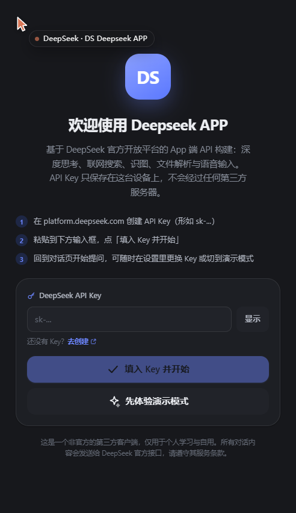
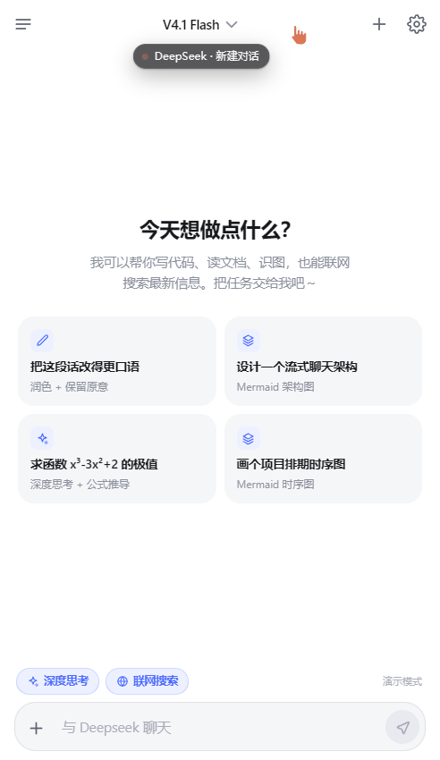
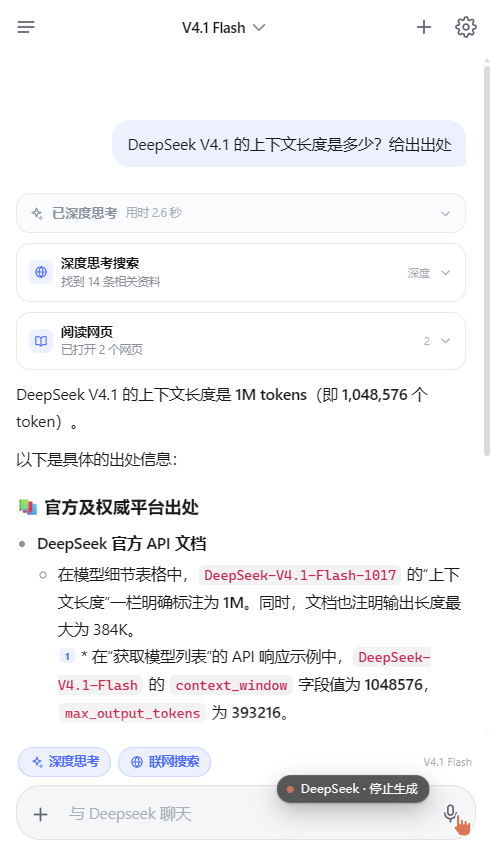
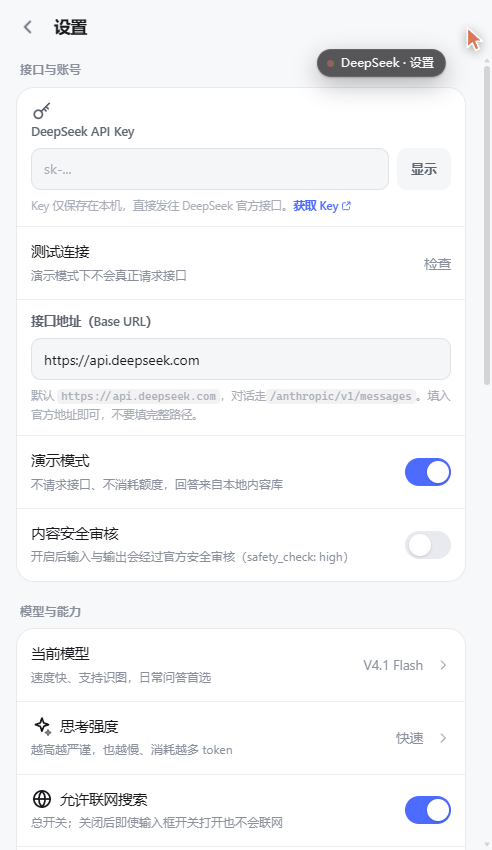
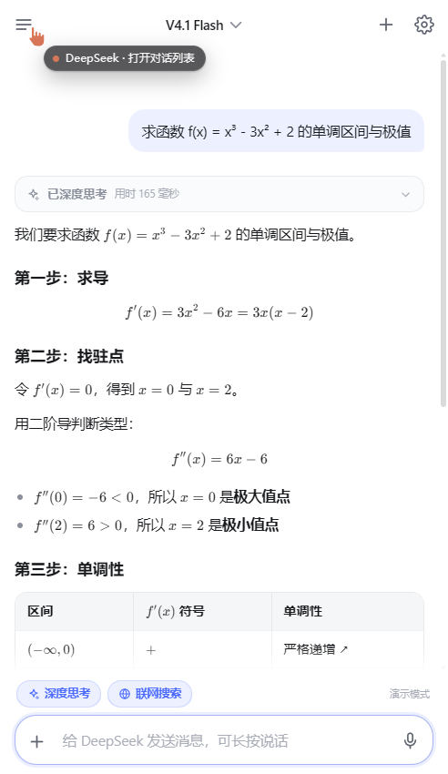
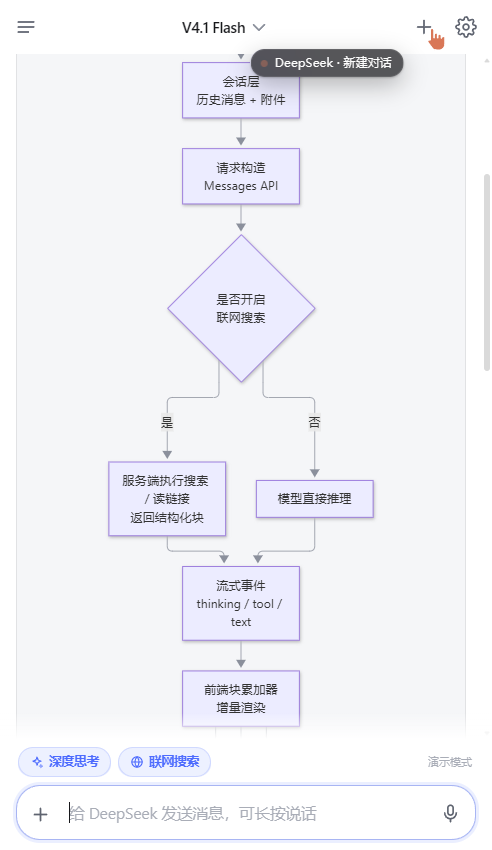
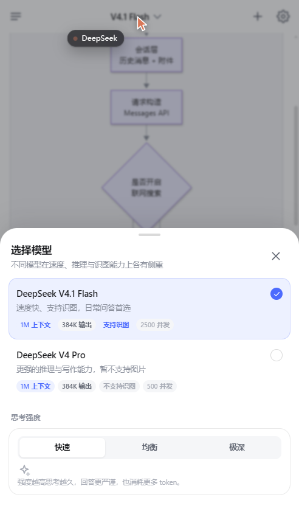
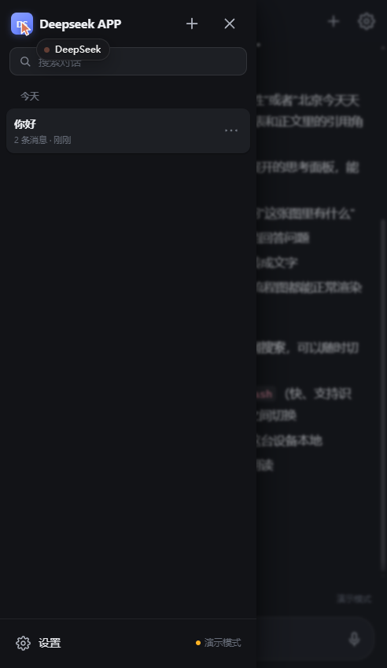
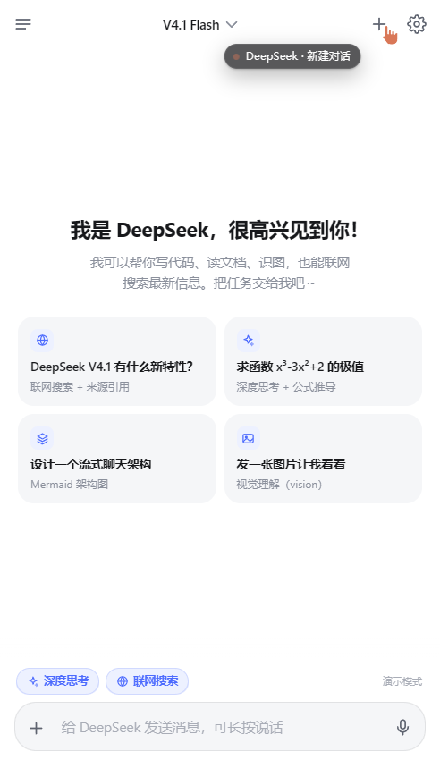

# Deepseek APP

[](https://github.com/Sauomore/Deepseek-APP/releases/latest)
[](LICENSE)
[](#下载安装)
[](#技术栈)

一个基于 **DeepSeek 官方开放平台 App 端全套 API** 构建的手机客户端，视觉与交互对齐官方 DeepSeek App：
深度思考折叠面板、联网搜索来源卡片、正文引用角标、识图、文档解析、语音输入，以及完整的
Markdown / LaTeX / 代码高亮 / Mermaid 渲染。

应用标识为纯文字 **DS** 字标（无插画 logo），桌面图标与应用名均为 `Deepseek APP`。

- 前端：React 19 + TypeScript + Vite 7
- 容器：Capacitor 8 → 可安装的 Android APK（同一份代码也能作为 PWA 在 iOS Safari 中使用）
- 数据：纯客户端直连 `api.deepseek.com`，**API Key 只保存在本机**，不经过任何中转服务器

> 非官方项目，仅用于个人学习与自用。所有对话内容会发送给 DeepSeek 官方接口，请遵守其服务条款。
> 本项目已用真实 API Key 逐条验证过对话、联网搜索、引用、多轮上下文、识图、文档解析与语音识别。

---

## 下载安装

直接下载签名好的 APK 覆盖安装即可（无需 root、无需 Google 服务）：

**[⬇ 下载最新版 APK](https://github.com/Sauomore/Deepseek-APP/releases/latest)**

| 项目 | 说明 |
| --- | --- |
| 系统要求 | Android 7.0（API 24）及以上 |
| 安装包大小 | 约 6 MB |
| 权限 | 网络、麦克风（语音输入），无任何统计/追踪 SDK |
| 首次使用 | 填入自己的 [DeepSeek API Key](https://platform.deepseek.com/api_keys)，或点「先体验演示模式」 |

> 更新日志见 [CHANGELOG.md](CHANGELOG.md)，App 内「设置 → 关于 → 更新日志」也能随时查看。


---

## 界面预览

| 欢迎页 | 空状态（深色） | 联网搜索与来源（真实 API） | 设置 |
| --- | --- | --- | --- |
|  |  |  |  |

| 数学公式（KaTeX） | Mermaid 架构图 | 模型选择 | 会话列表 |
| --- | --- | --- | --- |
|  |  |  |  |

| 浅色模式 |
| --- |
|  |

---

## 功能

| 能力 | 说明 |
| --- | --- |
| 流式对话 | SSE 增量渲染，逐字打字机效果，可随时停止 |
| 深度思考 | 折叠面板显示思维链，自动展开/收起，显示耗时 |
| 联网搜索 | 搜索步骤卡片 + 来源列表（标题 / 站点 / 时间 / 摘要）+ 正文引用角标，可点击跳转 |
| 深度思考搜索 | 思考与搜索交替的 `deep_search` 流程同样支持 |
| 识图 | 相册 / 拍照，本地压缩后以 base64 送入 `deepseek-flash` 视觉能力 |
| 文档解析 | PDF / Word / PPT / Excel / TXT / MD / CSV，走 Files API 服务端解析 |
| 语音输入 | **长按空白输入框**录音，松手自动转文字（录音 → 16kHz 单声道 WAV → ASR） |
| 发送方式 | 右侧发送按钮常驻（无内容时灰显），回车只换行 |
| 输入框 | 默认一行，自动扩展到三行为上限；超出后内部滚动并始终显示最新内容；到三行时右上角出现**全屏编辑**按钮 |
| 富文本渲染 | Markdown、KaTeX 公式、代码高亮 + 一键复制、Mermaid 图表（右上角可**保存为 PNG**）、表格横向滚动 |
| 首页推荐 | 从 24 条提示词库中随机推荐 4 个问题，每次新建会话重新抽取（可在设置里关闭） |
| 更新公告 | 安装/升级后首次打开弹出「更新公告」，设置里也可随时查看完整更新日志 |
| 系统提示词 | 支持自定义，改动后**已有对话的下一轮自动重新注入**（flash 走 in-history 追加，v4-pro 走 leading-only） |
| 生成参数 | 思考强度 关闭/低/高/极高（官方 effort），最大输出 token 可选（默认交给服务端） |
| 模型切换 | `deepseek-flash`（快、支持识图）/ `deepseek-v4-pro`（推理更强） |
| 会话管理 | 自动标题、重命名、置顶、删除、搜索、本地持久化 |
| 外观 | 深色 / 浅色 / 跟随系统，三档正文字号 |
| 演示模式 | 无需 API Key，本地内容库模拟完整流式事件，可完整体验全部 UI 与交互 |

---

## 快速开始（开发）

```bash
npm install
npm run dev          # http://localhost:5173
```

首次打开会进入引导页：填入自己的 DeepSeek API Key，或选择「先体验演示模式」。

## 构建 Android APK

前置条件：JDK 21、Android SDK（platform 36 / build-tools 36）、Node 20+。

```bash
npm run apk          # debug
npm run apk:release  # 已签名的 release 包
```

产物：

```
android/app/build/outputs/apk/debug/app-debug.apk
android/app/build/outputs/apk/release/app-release.apk
release/Deepseek-APP-1.0.8-release.apk   ← 直接安装这个
```

完整步骤（含 release 签名）见 [docs/BUILD.md](docs/BUILD.md)。

## 接入真实模型

1. 打开 App → 右上角齿轮 → **接口与账号**
2. 填入 API Key（形如 `sk-...`，在 <https://platform.deepseek.com/api_keys> 创建）
3. 关闭 **演示模式**，点「测试连接」确认可用

Key 保存在本机 `localStorage`，随请求以 `x-api-key` 头发往 `https://api.deepseek.com/anthropic/v1/messages`。
App 不含任何统计、追踪或第三方上报。

---

## 技术栈

| 层 | 选型 |
| --- | --- |
| UI | React 19 + TypeScript 5.9 |
| 构建 | Vite 7（ESM、按需拆包；Mermaid 异步加载） |
| 移动容器 | Capacitor 8（Android，`androidScheme: https` 让 WebView 直连 API 免代理） |
| 状态 | zustand 5 + idb-keyval（会话/设置持久化在设备本地 IndexedDB / localStorage） |
| 渲染 | markdown-it + KaTeX + highlight.js + Mermaid + DOMPurify |
| 原生能力 | 状态栏、键盘、触感、文件系统与分享（Mermaid 导出） |

## 架构

```
src/
├─ api/                 与 DeepSeek 接口打交道
│  ├─ client.ts         Messages 协议客户端：SSE 解析、错误归一化、Files API、ASR
│  ├─ request.ts        由本地会话状态构造请求（工具声明、title、effort…）
│  ├─ accumulator.ts    流式事件 → 内容块数组（支持多段思考 / 工具卡片）
│  └─ mock/             演示模式：内容库 + 完全对齐真实协议的事件模拟器
├─ components/          UI 组件（聊天、消息块、输入框、抽屉、设置…）
├─ lib/                 markdown 管线、音频编码、图片压缩、存储、格式化
├─ store/               zustand：会话 / 设置 / UI 状态
└─ styles/              设计 token 与各区域样式
```

**数据流**

```
发送消息
  → 构造 Messages 请求（tools: deepseek_web_search / deepseek_read_url，title 仅首轮）
  → fetch + ReadableStream 解析 SSE（演示模式下由 mock 引擎发出同构事件）
  → BlockAccumulator 按 index 累加 thinking / server_tool_use / tool_result / text
  → 每 40ms 刷入 React，Markdown 渲染 + 引用角标
  → 会话与消息落 IndexedDB（流式过程中不写盘）
```

**协议选择**：使用 Anthropic 兼容的 `POST /anthropic/v1/messages`，而不是 Chat Completions。
原因是该协议把 App 需要展示的内容直接建模成离散的 block（`thinking`、
`server_tool_use` + `web_search_tool_result`、带 `citations` 的 `text`），
并且支持服务端 `title` 生成与 `safety_check`——官方 App 的界面对应关系见
[docs/API-INTEGRATION.md](docs/API-INTEGRATION.md)。

**为什么不需要后端**：DeepSeek API 对 `/anthropic/v1/messages`、`/files`、`/v1/tools/asr`、`/models`
均返回permissive CORS（回显 `Origin`），而 Capacitor 的 WebView 源固定为 `https://localhost`，
因此浏览器端可以直接携带用户自己的 Key 调用，无需代理。这一点在实现前已实测验证。

---

## 项目结构补充

| 路径 | 作用 |
| --- | --- |
| `android/` | Capacitor 生成的 Android 工程（已配置录音权限、关闭云备份） |
| `scripts/gen-assets.mjs` | 由内联 SVG 生成全部图标与启动图（`npm run assets`） |
| `docs/research/raw/` | 官方 API 文档的离线抓取副本（Markdown），便于离线查阅 |
| `artifacts/` | 设计过程中的截图与图标候选（不参与构建） |

## 已验证（真实 API）

用真实 API Key 逐条跑通过：

| 链路 | 结果 |
| --- | --- |
| 流式对话 + 思考面板 | ✅ 事件序列、`signature`、usage 全部符合 |
| 联网搜索 | ✅ 真实一次搜索返回 13–19 条来源、多个 `open_page`、思考与工具交替 |
| 引用角标 | ✅ 编号与来源一一对应，被引用来源自动排到卡片前面 |
| 多轮上下文 | ✅ 回传思考块 + 工具块（含 `signature`）无 400，第二轮正确引用上文 |
| 识图 | ✅ 上传图片后准确描述图中形状与颜色 |
| 文档解析 | ✅ 上传 DOCX 后正确抽出代号/负责人/预算；PDF 富版面、XLSX 表格均验证 |
| 语音识别 | ✅ 用系统 TTS 生成 16k 单声道 WAV，转写结果逐字一致 |
| 错误处理 | ✅ 无效 Key 返回友好提示 + 服务端原因 + 重试按钮 |

## 已知限制

- **演示模式**回答来自本地内容库，不调用模型；识图/文档/语音在演示模式下返回预设结果。
- 语音识别要求 16-bit PCM WAV 或 Ogg Opus：App 内已把录音重采样为 16kHz 单声道 WAV。
- `deepseek-v4-pro` 不支持图片，切到该模型时添加图片会给出提示。
- 文本/表格类文件（txt/md/csv/xlsx 等）走 `user_data` 上传通道，大小上限 32MB；PDF/Word/PPT 走解析通道，上限 100MB。
- 应用体积约 6–7MB，其中约 4MB 是 Mermaid 图表解析器（按需异步加载，不影响首屏）。
- 未内置 TTS 朗读、多语言界面（不在本次需求范围内）。
- 未在真机上安装验证（开发机无设备且无硬件虚拟化），APK 结构与打包产物已静态核对。

## 关于

- **项目主页**：https://github.com/Sauomore/Deepseek-APP
- **问题反馈**：[Issues](https://github.com/Sauomore/Deepseek-APP/issues)（请勿在 issue 里贴 API Key）
- **更新日志**：[CHANGELOG.md](CHANGELOG.md)
- **构建与调试**：[docs/BUILD.md](docs/BUILD.md) · **API 接入说明**：[docs/API-INTEGRATION.md](docs/API-INTEGRATION.md) · **QA 报告**：[docs/QA-REPORT.md](docs/QA-REPORT.md)

## 许可与声明

本项目为个人使用的非官方客户端，与 DeepSeek 官方无关。DeepSeek 名称与商标归其所有。

代码以 [MIT License](LICENSE) 开源，可自由用于学习参考；请勿用于任何违反 DeepSeek 服务条款的用途。
使用本项目需要自备 DeepSeek API Key，产生的费用由使用者自行承担。
