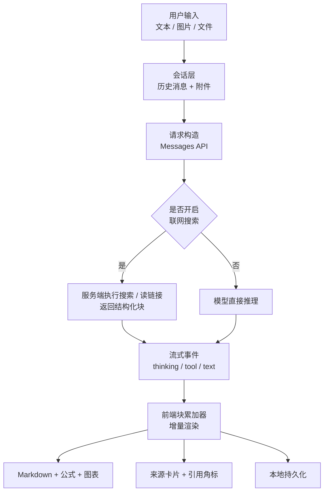
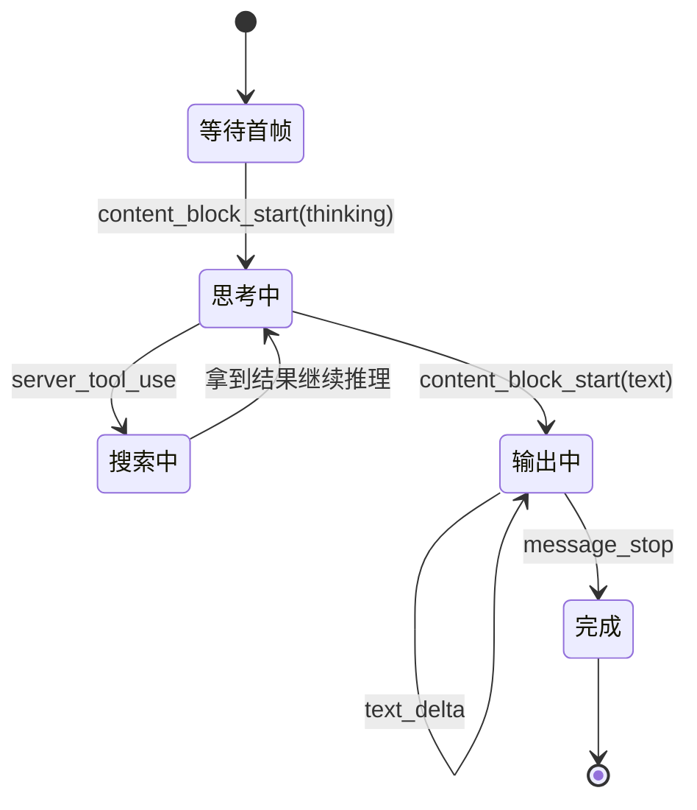

一个典型的流式聊天架构可以拆成五层，关键在于**服务端把"要客户端自己拼的东西"都收敛成了结构化事件**：

### 各层职责

1. **会话层**：只存"用户看得到的消息"和"下一轮要原样回传的块"，两者可以是同一份数据结构。
2. **请求构造**：把附件转成 `image` / `document` 块，把开关转成 `tools` 声明。
3. **服务端工具**：搜索和读链接都在服务端跑，客户端不接触网页内容，只拿到带 `sources` 的结果块。
4. **块累加器**：这是最核心的一块，见下面的状态机。
5. **渲染层**：Markdown 走统一管线，Mermaid 和代码块按需异步加载。

### 块累加器的状态流转

这里有个容易忽略的细节：**思考可能在一次回答里出现多次**（先思考、再搜索、再思考、最后输出）。所以累加器必须是"按 `index` 维护块数组"，而不是"当前只有一个块"。

需要我把这个累加器写成可以直接用的 TypeScript 实现吗？
